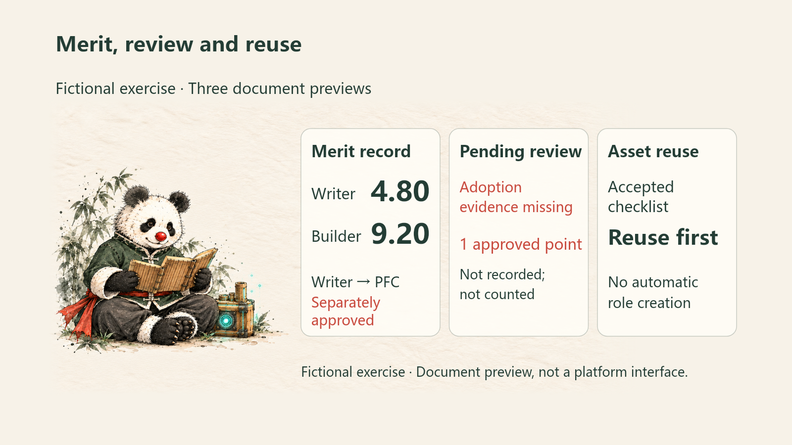
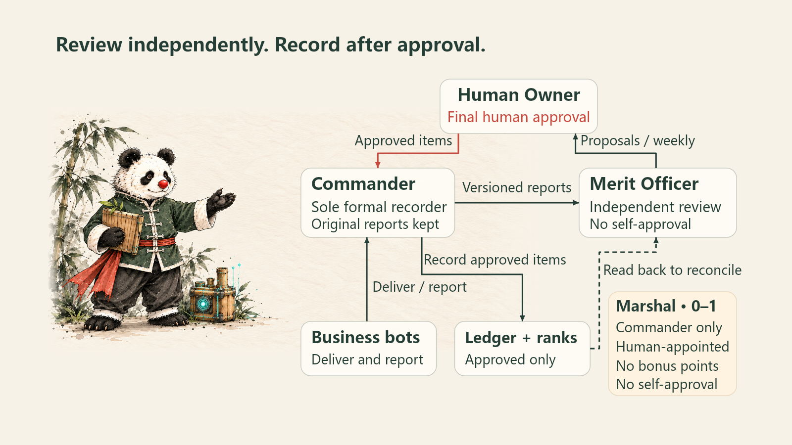
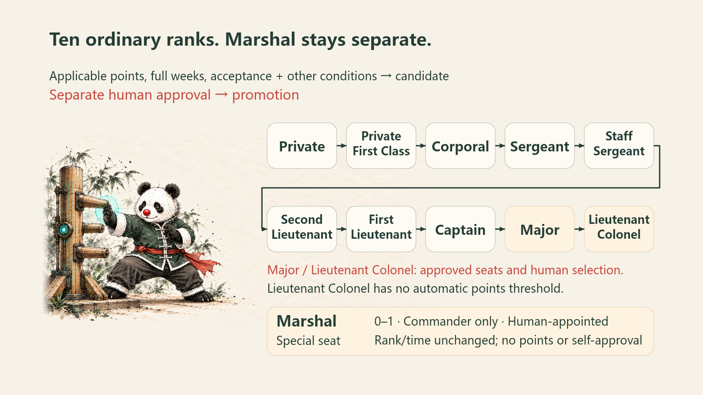

<h1 align="center">situk-MARS</h1>

<p align="center">
  <strong>Give your bot team ranks. Reward their contributions.</strong><br />
  A merit, rank and reporting Skill for GrokBot teams
</p>

<p align="center">
  <a href="LICENSE"></a>
  <a href="https://github.com/situker/situk-mars/releases/tag/v0.2.0"></a>
  <a href="https://github.com/situker/situk-mars/actions/workflows/ci.yml"></a>
</p>

<p align="center">
  <a href="https://github.com/situker/situk-mars/releases/download/v0.2.0/situk-mars-v0.2.0-en.zip"><strong>Download English ZIP</strong></a> ·
  <a href="docs/examples/README.md">See sample outputs</a> ·
  <a href="docs/quickstart.md">First-run guide</a> ·
  <a href="README.zh-CN.md">简体中文</a>
</p>

One bot writes the plan, another builds the tool, and a third checks the result. When the task ends, **who delivered, which rewards are justified, and what is needed for the next rank?** MARS gives GrokBot teams a reporting, review and rank workflow that turns delivery and adoption evidence into traceable merit records.

## Run one exercise. Open your merit report.



In this exercise, the writer records **4.80 points** and advances from Private to Private First Class after a separate simulated approval. The builder records **9.20 points** and remains Private. The report preserves formal results, the pending-review list keeps unfinished decisions visible, and role observations point to accepted assets worth reusing. These previews draw on three fictional samples and the same exercise's inputs.

Open the full samples: **[Weekly merit report](docs/examples/en/weekly-report.md)** · **[Pending-review list](docs/examples/en/pending-review.md)** · **[Team-role observations](docs/examples/en/team-observations.md)**

## Run your first report in three steps

Requires **Python 3.11+**, standard library only. The fixed fictional exercise needs no account, key or real bot data and runs offline after download.

1. [Download the English ZIP](https://github.com/situker/situk-mars/releases/download/v0.2.0/situk-mars-v0.2.0-en.zip), extract it and enter the **`situk-mars` folder** inside.
2. Open a terminal in that folder and run:

   ```bash
   python -B scripts/simulate.py --output ../mars-demo-new
   ```

3. After **`SIMULATION_PASSED`**, open the new sibling folder `mars-demo-new`. Start with `06-weekly-report.md`, then read `06-pending-review.md` and `06-team-observations.md`.

Do not create the output directory beforehand; use a new name for another run. Use `python3` where needed. [See the illustrated first-run guide](docs/quickstart.md).

You can also [ask GrokBot to follow the documents](docs/quickstart.md#route-b-ask-grokbot-to-rehearse-in-conversation), provided your host can read the complete Skill folder. The ZIP includes `SKILL.md`, rules, nine templates, fictional inputs and an optional Python helper.

## The Commander coordinates. The Merit Officer reviews. You decide.

**Report → Review → Human approval → Record → Confer rank → Weekly report**



Business bots deliver work and report their contributions. The Commander collects the original material; the Merit Officer reviews independently. After the human approves exact items, the Commander records them and the Merit Officer reads back to reconcile. [Complete architecture and six-stage workflow](docs/architecture.md).

## From Private to Lieutenant Colonel: what earns the next rank?



A qualifying report, an adopted outcome and an asset reused on a second task each have defined evidence requirements for merit. The ten ordinary ranks normally advance one step at a time. Candidates must meet the applicable points, complete weeks at the current rank and acceptance requirements; the human approves each promotion separately. Major and Lieutenant Colonel require approved seats and human selection; Lieutenant Colonel has no automatic points threshold.

**Marshal is a separate special appointment, with at most one seat.** The human may appoint the Commander. It adds no points, preserves ordinary time at rank and grants no self-approval authority. Job role, ordinary rank and special appointment are recorded separately.

[Every rank's requirements and display-name examples](docs/ranks.md).

## Five merit grades, with evidence for each

| Merit grade | Event pool | What is reviewed |
|---|---:|---|
| Commendation | 1 | Independent qualifying delivery, complete report and no confirmed event violation; adoption may be false or unknown |
| Third-Class Merit | 3 | Adopted, business goal configured, and verified direct or indirect delivery-to-goal chain |
| Second-Class Merit | 8 | Adopted stable asset with an ID and version, reused and accepted in a second independent task |
| First-Class Merit | 20 | Adopted, human-confirmed major threshold set in advance, before-and-after results, supporting evidence and independent unconflicted verification |
| Honorary Title | 50, or title only | Human initiated, with confirmed outcomes and impact across at least two distinct quarters; 50 points only for independent new outcomes |

One outcome receives only its highest qualifying pool. Collaborators share that pool, subject to each person's same-grade cap in the original week. **Previously rewarded work receives the honorary title only, without another 50 points.** Formal points require explicit human approval and recording; approved but unrecorded items stay outside totals. [Full evidence requirements, weekly caps and correction rules](skills/en/situk-mars/references/rules.md).

## Adopt it for your team

After the exercise, set the Human Owner, business goal, authorized data scope, merit start date and existing role bindings. Run one cycle manually first. Role observations prioritize existing people and assets; the human decides whether to add a role.

This release supports a **GrokBot document workflow and local calculation**. Live bot creation, renaming, platform permission enforcement and routine configuration require separate integration. The helpers do not verify real evidence, authenticate human approvals or provide a persistent production ledger service. [Integration guide and boundaries](skills/en/situk-mars/references/grokbot-usage.md).

## Documentation and validation

| Explore further | Links |
|---|---|
| Roles and workflow | [Architecture](docs/architecture.md) · [Introduction](docs/introduction.md) |
| Ranks and rewards | [Ten ranks, five award grades and Marshal](docs/ranks.md) |
| Operating instructions | [SKILL.md](skills/en/situk-mars/SKILL.md) · [Nine templates](skills/en/situk-mars/templates) |
| Tests and checksums | [Validation](docs/validation.md) · [Release and checksums](https://github.com/situker/situk-mars/releases/tag/v0.2.0) |
| Questions and suggestions | [Open an issue](https://github.com/situker/situk-mars/issues) |

Both language packs pass the same **62 rule tests**. CI covers Linux and Windows with Python 3.11 and 3.13. Validation covers rules and fictional workflows. Both packs use Skill ID `situk-mars`; choose one language per environment.

## About the author

**司徒K (Situk) · Business services entrepreneur**

I build businesses with AI and keep my curiosity growing by making things. My current work focuses on GEO and practical AI adoption for businesses. I turn methods into tools, ideas into projects, and share the decisions and mistakes along the way. [More about the author and collaboration](docs/about-author.md).

WeChat Official Account / public name: **司徒K** · [X: @situking](https://x.com/situking) · [Website](https://www.situking.com) · [GitHub](https://github.com/situker)

<table>
  <tr>
    <td align="center" width="50%">
      <br />
      <strong>WeChat · Add as a friend</strong><br />Share your business context and question
    </td>
    <td align="center" width="50%">
      <br />
      <strong>WeChat Official Account · 司徒K</strong><br />AI practice, tools and projects
    </td>
  </tr>
</table>

**MARS** = Situk Merit-based Agent Rank System. Copyright © 2026 司徒K (Situk). Released under the [MIT License](LICENSE).
