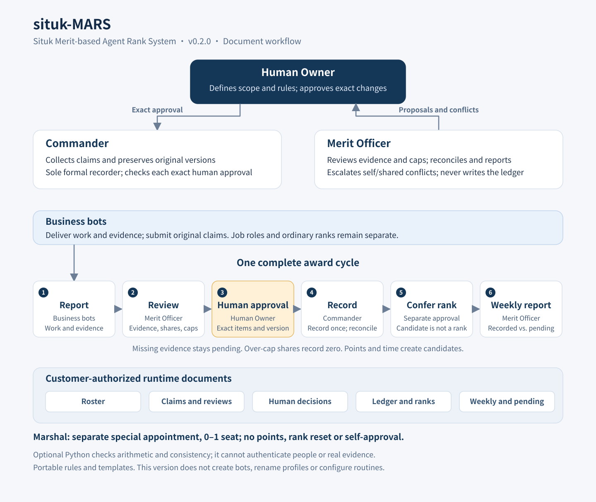

# situk-MARS

**Situk Merit-based Agent Rank System (MARS)**

**Give your bot team ranks. Reward their contributions.**

[简体中文](README.zh-CN.md) · [Architecture](docs/architecture.md) · [Introduction](docs/introduction.md) · [About the author](docs/about-author.md) · [MIT License](LICENSE)

situk-MARS is a military-style rank and merit system for GrokBot teams. It gives you a consistent way to report contributions, review the evidence, approve rewards, record points, confer ranks and see the results each week.

The aim is simple: make useful work visible and give every reward a clear reason. The **Commander** coordinates the process, the **Merit Officer** reviews it, and the **Human Owner** makes the final decisions.



## When your bot team needs a shared record

One bot drafts a plan. Another turns it into a working tool. A third checks the result. A week later, their contributions are spread across conversations, and it is hard to tell what was delivered, what was adopted and who contributed to the outcome.

MARS brings those questions into one document workflow:

- What did each bot deliver, and who accepted or adopted it?
- Which contributions deserve an award, and how should collaborators share it?
- Which awards are approved and recorded, and which are still waiting?
- Who is eligible for promotion, and what needs the owner's decision?

The records focus on inspectable work and evidence. Message counts, time online and a bot's own praise do not establish merit.

## Who does what

| Role | Responsibility |
|---|---|
| Human Owner | Approves exact award items, promotions and special appointments; handles conflicts that need human review |
| Commander | Collects reports, prepares proposals and is the sole writer of the official ledger under valid approval |
| Merit Officer | Reviews evidence, checks duplicates, shares and caps, then independently reconciles the records |
| Business bots | Deliver work, report their contributions and provide acceptance or adoption evidence |

**Commander is a job role. Marshal is a separate special appointment.** The Human Owner may appoint zero or one Marshal, held by the Commander. It grants no points, does not reset the ordinary-rank clock and gives no authority to approve one's own awards.

The Merit Officer's own cases, and cases involving both governance roles, go to the Human Owner or an unconflicted third party designated in advance by that human. If a role is unfilled, the human can cover it while a separate setup proposal is considered.

## The six-stage workflow

**Report → Review → Human approval → Record → Confer rank → Weekly report**

1. **Report:** describe the delivery, contributors, acceptance or adoption, and evidence.
2. **Review:** check the evidence, duplicate events, contribution shares, original-week caps and conflicts of interest.
3. **Human approval:** obtain a traceable decision for the exact proposal and its items.
4. **Record:** the Commander posts the approved result once. Approved but unrecorded points stay outside formal totals.
5. **Confer rank:** check eligibility, submit a separate promotion proposal and record the human decision.
6. **Weekly report:** produce a merit report, a pending-review list and team-role observations.

Meeting a rank threshold creates a candidate. Conferring the rank still needs a separate approval. Team-role observations can identify gaps or duplicated work; they do not automatically create bots or change responsibilities.

## The rules behind the rewards

| Mechanism | Rule |
|---|---|
| Five award grades | Commendation **1**; Third-Class Merit **3**; Second-Class Merit **8**; First-Class Merit **20**; Honorary Title **50** only for independent new outcomes |
| Honorary Titles for earlier work | Previously awarded outcomes receive the title only, without another **50** points |
| Shared contributions | One event has one award pool. Contribution shares total **100%**, with deterministic rounding |
| Weekly caps | Apply each bot's same-grade cap in the original week. A capped share records **0**; it is not redistributed, downgraded or carried forward |
| Ranks | **Ten ordinary ranks**, plus the separate **0–1 Marshal** appointment |
| Approval and recording | Approval binds an exact proposal. Replaying it cannot award points or confer a rank twice |

The release includes a complete Skill, rules, **nine reusable templates**, and optional Python helpers for calculations and the fictional exercise. The two language packs implement the same **0.2.0 rules**.

## Start with one language pack

- [English Skill](skills/en/situk-mars/SKILL.md)
- [简体中文 Skill](skills/zh-CN/situk-mars/SKILL.md)
- [Download the existing v0.2.0 release](https://github.com/situker/situk-mars/releases/tag/v0.2.0)

The packs share the same Skill ID, `situk-mars`. Choose one per environment.

Give the complete chosen Skill folder to GrokBot and begin with `SKILL.md`. Set the Human Owner, business goal, authorized data directory, merit start date and existing role bindings. Run a fictional exercise before applying the workflow to your team.

## Try it locally

Python **3.11+** and its standard library are sufficient. The exercise needs no network, account, API key or dependency installation.

```bash
git clone https://github.com/situker/situk-mars.git
cd situk-mars
python3 -B skills/en/situk-mars/scripts/simulate.py --output .local/demo-en
python3 -B -m unittest discover -s skills/en/situk-mars/tests -p test_merit_engine.py -v
```

On Windows, use `python` if that is your Python 3 command. Leave the final output directory uncreated, even as an empty folder: the exercise refuses to overwrite an existing directory. Keep runtime files outside the Skill source folder.

The English pack produces English documents by default. Use the Chinese pack for Chinese output, or select `--lang en` / `--lang zh-CN`. Machine-readable rank keys remain Chinese for compatibility; English display labels are mapped separately.

## What the fictional example demonstrates

| Fictional bot | Recorded points | Result |
|---|---:|---|
| Example Writer | **4.80** | Becomes Private First Class after a separate simulated promotion approval |
| Example Builder | **9.20** | Remains Private; eligibility alone does not confer a rank |
| Example Merit Officer | **0.00** | An approved but unrecorded **1-point** item stays outside formal totals |
| Example Commander | **0.00** | The Marshal appointment adds no points and preserves the ordinary-rank clock |

A shared event divides one **3-point** pool into **1.80** and **1.20**. The writer's third same-grade award records **0** after the weekly cap. Missing adoption evidence stays pending. Replaying an approved decision creates no duplicate reward or promotion.

Both language packs passed the same **62 rule tests**. The original rules also passed **three local fictional runs**, and GrokBot separately ran the same **62 cases** and exercise. The published v0.2.0 workflow passed **four CI combinations**: Linux and Windows, each with Python **3.11** and **3.13**. These are checks of rule behavior and compatibility, not customer results or production bot acceptance. See [validation details](docs/validation.md) and [Actions](https://github.com/situker/situk-mars/actions).

## Current scope

MARS currently runs as a document workflow with local helpers. Creating roles, installing Skills into bots, renaming live profiles, enforcing platform permissions and scheduling routines require separate implementation. A proposed rank suffix is a target name, not a completed profile change.

The helpers calculate deterministic results; people still need to verify real-world evidence and provide traceable human approval. They do not authenticate people or supply a persistent production ledger service. Complex corrections, revocations, disciplinary action, exceptional promotion and Marshal replacement use manual proposals and decisions in this release.

Ranks and medals are management labels within the bot team. They grant no platform permissions or cash rewards.

## About the author

**司徒K (Situk) · Business services entrepreneur**

I build businesses with AI and keep my curiosity growing by making things. My current work focuses on GEO and practical AI adoption for businesses. I turn methods into tools, ideas into working projects, and share the decisions and mistakes along the way.

[Website: www.situking.com](https://www.situking.com) · [X: @situking](https://x.com/situking) · [GitHub: situker](https://github.com/situker) · WeChat Official Account: **司徒K**

<table>
  <tr>
    <td align="center" width="50%">
      
      <br />
      <strong>WeChat · Add as a friend</strong>
    </td>
    <td align="center" width="50%">
      
      <br />
      <strong>WeChat Official Account · 司徒K</strong>
    </td>
  </tr>
</table>

Read [more about the author](docs/about-author.md). If the project helps you, a star or an issue describing your experience is welcome.

## License

Copyright © 2026 **司徒K (Situk)**. Released under the [MIT License](LICENSE).
