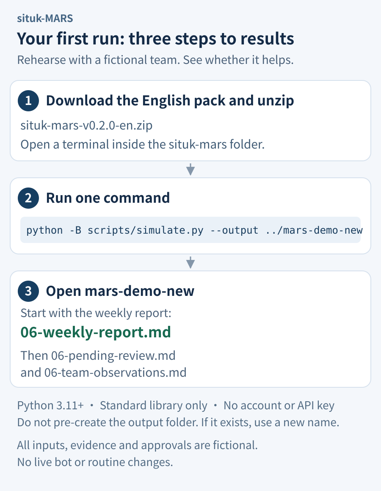

# situk-MARS

**Give your bot team ranks. Reward their contributions.**

For GrokBot teams with multiple bots, MARS turns scattered delivery and adoption records into a **weekly merit report, a pending-review list and team-role observations**. See who delivered what, which work was adopted and what still needs your decision.

The Merit Officer reviews independently. You approve awards and promotions. Start with a fictional team before deciding how to adopt the workflow for your own bots.

**[Download English ZIP](https://github.com/situker/situk-mars/releases/download/v0.2.0/situk-mars-v0.2.0-en.zip) · [See a sample report](docs/examples/en/weekly-report.md) · [First-run guide](docs/quickstart.md) · [简体中文](README.zh-CN.md)**

MIT licensed · English and Chinese · Document Skill with nine templates · Optional local Python helper

**Situk Merit-based Agent Rank System (MARS)**

## See what the exercise produces

In one fictional shared guide, the writer supplies the instructions and the builder supplies a verification checklist. The two parts are adopted as one outcome and share 3 points: 1.80 for the writer and 1.20 for the builder. These shares contribute to the totals shown below.


*These previews combine three local documents and their fictional exercise inputs.*

| Result | What to look for | Full sample |
|---|---|---|
| **Weekly merit report** | Recorded merit, ordinary ranks and special appointments | [Read the report](docs/examples/en/weekly-report.md) |
| **Pending-review list** | Missing evidence, pending decisions and approved but unrecorded items | [Read the list](docs/examples/en/pending-review.md) |
| **Team-role observations** | Reusable assets, duplicated work and responsibilities worth reviewing | [Read the observations](docs/examples/en/team-observations.md) |

In the exercise, the writer records 4.80 points and becomes Private First Class after a separate simulated approval. The builder records 9.20 and remains Private. The Merit Officer's approved but unrecorded 1-point item stays outside totals. **Points, eligibility, approval and formal recording remain separate.**

## Download, then try one exercise

The ZIP contains a `situk-mars` folder with `SKILL.md`, rules, nine templates, fictional inputs, and optional calculation and exercise scripts. **Choose either route below.** The fixed exercise needs no configuration of your real team.

### Route A: generate the documents locally

Requires Python 3.11+ and its standard library. The exercise needs no account, key or network connection.



1. [Download the English ZIP](https://github.com/situker/situk-mars/releases/download/v0.2.0/situk-mars-v0.2.0-en.zip), extract it and open the `situk-mars` folder inside.
2. Open a terminal in that folder and run this one command:

```bash
python -B scripts/simulate.py --output ../mars-demo-new
```

3. After `SIMULATION_PASSED`, open the new sibling folder `mars-demo-new`. Read `06-weekly-report.md` first, followed by `06-pending-review.md` and `06-team-observations.md`.

Use `python3` where needed. **Do not create `mars-demo-new` beforehand.** It must be outside the Skill folder and must not already exist. For another run, choose a new output name and keep the earlier results. See the [full first-run guide](docs/quickstart.md).

### Route B: ask GrokBot to follow the documents

Place the complete extracted folder somewhere your current GrokBot host can read, provide the actual path to `SKILL.md`, and send:

> Read this situk-MARS Skill and run a complete fictional exercise in the current conversation: report, review, human approval, record, confer rank and weekly report. Use fictional bots and simulated approvals. Finish with the weekly merit report, pending-review list and team-role observations. Label all materials as an exercise. Do not read real rosters, install the Skill, create or modify bots, or change routines. If you cannot read the complete folder or perform a step, explain the gap without claiming completion.

This route depends on the host's file-reading and output capabilities; it does not assume GrokBot can run Python. Use Route A if you cannot provide access to the complete files. See [GrokBot handoff details](docs/quickstart.md).

## How an award becomes a record

**Report → Review → Human approval → Record → Confer rank → Weekly report**

Business bots submit specific deliverables, acceptance records and adoption evidence. The Merit Officer checks duplicate outcomes, contribution shares, weekly caps and conflicts. Once you approve the exact items, the Commander records them. Meeting a promotion threshold creates a candidate; the promotion needs its own approval.

| Role | Responsibility |
|---|---|
| **Human Owner: you** | Sets business goals, adopts rules and gives final approval for awards, promotions and special appointments |
| **Commander** | Collects original reports and records formal ledger changes under valid approval |
| **Merit Officer** | Reviews and reconciles independently, then prepares reports; own or shared-conflict cases go to the human |
| **Business bots** | Deliver work, report contributions and provide evidence within their existing roles |

**Marshal is a separate special appointment.** The human may appoint the Commander to the team's single Marshal seat. It is recorded separately from the job role and ordinary rank, adds no points, preserves ordinary time at rank and grants no self-approval authority.

<details>
<summary>Expand the roles, workflow and document architecture</summary>


[Read the complete architecture](docs/architecture.md)

</details>

## Rules that keep rewards accountable

| Rule | Default behavior |
|---|---|
| Five grades | Commendation 1; Third-Class Merit 3; Second-Class Merit 8; First-Class Merit 20; Honorary Title 50 for an independent new outcome. Previously rewarded work receives the title only |
| One event, one pool | Collaborators share one pool according to evidence, with fixed rules for rounding |
| Individual weekly caps | 2 Commendations, 2 Third-Class Merits, 1 Second-Class Merit and 1 First-Class Merit. A capped share records 0 and is not redistributed, downgraded or deferred |
| Original-week attribution | Use the week of first qualifying delivery, Monday 00:00 to the next Monday 00:00 in Asia/Singapore |
| Ten ordinary ranks | Private to Lieutenant Colonel; points, complete weeks at the current rank and additional conditions create candidates. Promotions require separate approval |
| Approval and recording | Only approved and recorded points enter formal totals; replaying a decision creates no duplicate reward |

See the [full rules](skills/en/situk-mars/references/rules.md) for prerequisites, conflicts and corrections, and [SKILL.md](skills/en/situk-mars/SKILL.md) for the operating workflow. Both language packs use the Skill ID `situk-mars`; choose one per environment.

## Adopt it for your team after the exercise

Then set the Human Owner, business goal, authorized data directory, merit start date and existing role bindings. A human covers missing responsibilities while a separate staffing proposal is considered. Role observations prioritize existing people and assets.

The current release supports a **GrokBot document workflow** and local calculation. Live renaming, bot creation, installing into other bots, platform permission enforcement and routine configuration require their own integration and authorization; this release does not implement them automatically.

Reviewers must inspect real evidence and retain the source of human decisions. The helpers do not authenticate people or provide a persistent production ledger service. Complex corrections, revocations, discipline, exceptional promotions and Marshal replacement use human-reviewed templates. Ranks are fictional management titles, without real military status, employee compensation or cash rewards.

## Validation and further reading

Both packs passed the same **62 rule tests**. The workflow also passed four CI combinations: Linux and Windows, each with Python 3.11 and 3.13. These checks cover rules and fictional workflows, not customer outcomes.

[Validation](docs/validation.md) · [GitHub Actions](https://github.com/situker/situk-mars/actions) · [Introduction](docs/introduction.md) · [All exercise samples](docs/examples/README.md) · [Release and checksums](https://github.com/situker/situk-mars/releases/tag/v0.2.0)

## About the author

**司徒K (Situk) · Business services entrepreneur**

I build businesses with AI and keep my curiosity growing by making things. My current work focuses on GEO and practical AI adoption for businesses. I turn methods into tools, ideas into working projects, and share the decisions and mistakes along the way.

[Website: www.situking.com](https://www.situking.com) · [X: @situking](https://x.com/situking) · [GitHub: situker](https://github.com/situker) · WeChat Official Account: **司徒K**

<table>
  <tr>
    <td align="center" width="50%">
      
      <br />
      <strong>WeChat · Add as a friend</strong>
    </td>
    <td align="center" width="50%">
      
      <br />
      <strong>WeChat Official Account · 司徒K</strong>
    </td>
  </tr>
</table>

Read [more about the author](docs/about-author.md). If the project helps you, a star or an issue describing your experience is welcome.

## License

Copyright © 2026 **司徒K (Situk)**. Released under the [MIT License](LICENSE).
