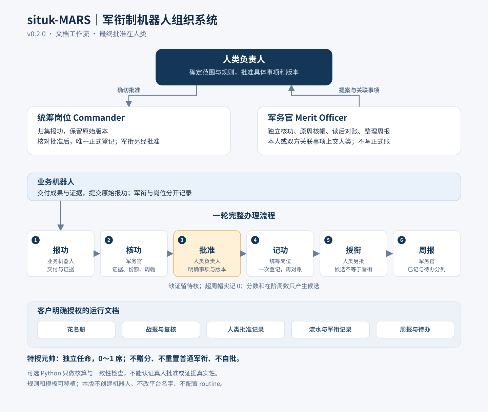

# situk-MARS｜军衔制机器人组织系统

**给 GrokBot 团队一套按证据论功、按批准授衔的奖赏制度。**

[English](README.md) · [架构图](docs/architecture.zh-CN.md) · [项目介绍](docs/introduction.zh-CN.md) · [MIT 许可证](LICENSE)

机器人交付了什么、谁采用了、值多少军功、该不该晋升，都留下依据。**元帅/统筹者负责组织，军务官负责独立核验，人类负责人保留最终决定。**



## 一轮制度怎样运转

**报功 → 核功 → 人类批准 → 记功 → 授衔 → 周报**

业务机器人提交交付、验收和采用证据。军务官查重、核对协同份额、个人周帽和利益冲突。你批准具体事项后，统筹者按批准登记。达到晋升条件只形成候选，具体授衔仍须单独批准。

## 包里有什么

| 内容 | 用途 |
|---|---|
| 完整 GrokBot Skill | 执行报功、核功、奖赏、军衔和周报的文档工作流 |
| 五档军功 | 嘉奖1、三等3、二等8、一等20；荣誉独立新成果50，旧成果只授称号 |
| 防刷功规则 | 一事一档、同池分摊、原周归属、个人周帽、确定性分币 |
| 军衔与特授 | 十级普通军衔；另设元帅0–1席特授，不赠分、不重置普通轨 |
| 九份模板 | 花名册、战报、复核、决定、流水、晋衔、周报、更正、岗位说明 |
| 本地 Python 辅助 | 确定性核算、批准绑定、去重、候选检查、虚构完整演练 |

中英两版使用同一套 **0.2.0 制度**。两版 Skill ID 相同，选择一种语言使用，不要同时安装。

## 选择语言与开始使用

- [简体中文 Skill](skills/zh-CN/situk-mars/SKILL.md)
- [English Skill](skills/en/situk-mars/SKILL.md)
- [下载 v0.2.0 中英语言包](https://github.com/situker/situk-mars/releases/tag/v0.2.0)

把选定语言的完整 Skill 文件夹交给 GrokBot，先读 `SKILL.md`，配置人类负责人、业务目标、已授权资料目录、新功起算与现有角色绑定。缺位职责先由人类承接，是否建岗另提方案。

本版交付制度 Skill 和本地辅助脚本。真实自动建机器人、向其他机器人安装 Skill、改名、平台权限隔离和 routine 配置均不包含在本版能力中。

## 本地跑一次虚构演练

Python 3.11+ 标准库即可，不需要联网、账号、密钥或安装依赖。

```bash
git clone https://github.com/situker/situk-mars.git
cd situk-mars
python -B skills/zh-CN/situk-mars/scripts/simulate.py --output .local/demo-zh
python -B -m unittest discover -s skills/zh-CN/situk-mars/tests -p test_merit_engine.py -v
```

Linux/macOS 没有 `python` 命令时用 `python3`。**不要预先创建最终输出目录，空目录也不行。** 脚本拒绝覆盖已有目录；运行产物应放在 Skill 源码目录之外。

输出包含六阶段说明、模拟军功账、授衔记录，以及军功周报、待复核清单、岗位观察三份文档。英文包默认输出英文，也可用 `--lang en` / `--lang zh-CN` 选择。机器数据中的军衔键保持中文，英文展示单独映射。

## 演练结果

| 虚构机器人 | 正式模拟分 | 结果 |
|---|---:|---|
| 示例主笔 | 4.80 | 单独模拟批准后，列兵升上等兵 |
| 示例构建员 | 9.20 | 保持列兵，没有自动授衔 |
| 示例军务官 | 0.00 | 已批未登记的1分不进入累计 |
| 示例统筹 | 0.00 | 元帅特授不赠分，普通轨起算保留 |

协同只分一个3分池，主笔1.80、构建员1.20。主笔第三份同档军功超周帽记0。缺采用证据停在待补。重放决定不重复加分、不重复授衔。

原制度通过62项本地规则测试和三次虚构演练；GrokBot随后独立执行相同62项测试及完整演练。它们证明本地规则行为，不能替代真实证据核验或平台运行验收。详见[验证记录](docs/validation.zh-CN.md)。

## 使用边界

辅助脚本不认证真人、不验证现实事实，也不是持久化生产账本服务。真实使用时，复核者须打开授权来源核验，保留可追溯的人类批准。岗位说明是行为约束，不能当成平台权限隔离。

复杂更正、撤奖、处分、破格和元帅撤换在本版走人工模板。军衔是自拟管理称呼，不是真实国家军衔、员工薪酬或现金奖励。

## 许可与作者

Copyright © 2026 **司徒K（Situk）**，采用 [MIT 许可证](LICENSE)。

[www.situking.com](https://www.situking.com)
