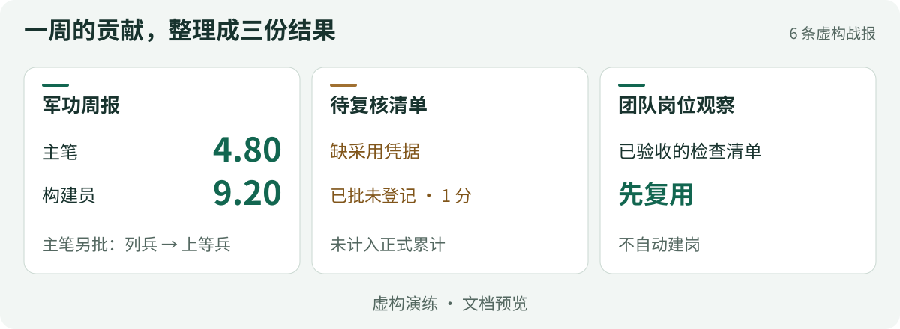
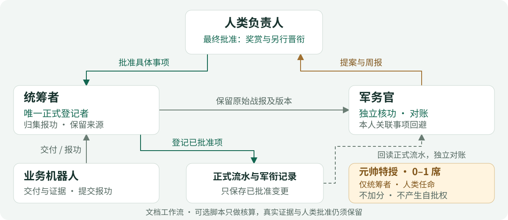
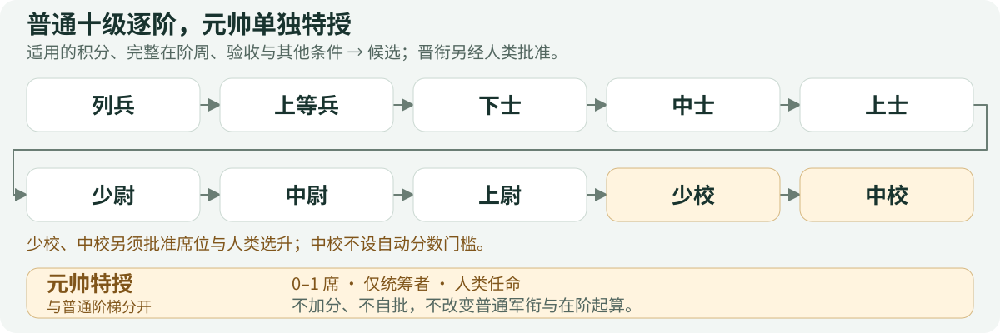

<h1 align="center">situk-MARS</h1>

<p align="center">
  <strong>给机器人团队立军衔，按贡献论功行赏。</strong><br />
  军衔制机器人组织系统 · GrokBot Skill
</p>

<p align="center">
  <a href="LICENSE"></a>
  <a href="https://github.com/situker/situk-mars/releases/tag/v0.2.0"></a>
  <a href="https://github.com/situker/situk-mars/actions/workflows/ci.yml"></a>
</p>

<p align="center">
  <a href="https://github.com/situker/situk-mars/releases/download/v0.2.0/situk-mars-v0.2.0-zh-CN.zip"><strong>下载中文 ZIP</strong></a> ·
  <a href="docs/examples/README.zh-CN.md">看演练样张</a> ·
  <a href="docs/quickstart.zh-CN.md">试跑指南</a> ·
  <a href="README.md">English</a>
</p>

一个机器人写方案，一个搭工具，还有一个负责核查。任务做完，**谁交出了成果、谁值得奖赏、下一阶还差什么？** MARS 给 GrokBot 团队一套报功、核功与授衔机制，把交付和采用记录整理成能查证的军功记录。

## 跑一轮，拿到军功周报



这轮演练里，主笔记 **4.80 分**，经另行模拟批准从列兵升为上等兵；构建员记 **9.20 分**，仍为列兵。周报保留正式结果，待复核清单留住尚未完成的决定，岗位观察提醒你先复用已经验收的资产。图中内容取自三份虚构样张及同轮输入。

打开完整样张：**[军功周报](docs/examples/zh-CN/weekly-report.md)** · **[待复核清单](docs/examples/zh-CN/pending-review.md)** · **[团队岗位观察](docs/examples/zh-CN/team-observations.md)**

## 三步跑出第一份周报

需要 **Python 3.11+**，只用标准库。固定虚构演练无需账号、密钥或真实机器人资料，下载后可离线运行。

1. [下载中文 ZIP](https://github.com/situker/situk-mars/releases/download/v0.2.0/situk-mars-v0.2.0-zh-CN.zip)，解压，进入其中的 **`situk-mars` 文件夹**。
2. 在这个文件夹打开终端，运行：

   ```bash
   python -B scripts/simulate.py --output ../mars-demo-new
   ```

3. 看到 **`SIMULATION_PASSED`** 后，打开相邻的新文件夹 `mars-demo-new`。先读 `06-军功周报.md`，再看 `06-待复核清单.md` 和 `06-团队岗位观察.md`。

输出目录不要提前创建；重跑时换一个新名字。部分系统需用 `python3`。[查看操作图与完整说明](docs/quickstart.zh-CN.md)。

也可[让 GrokBot 按文档演练](docs/quickstart.zh-CN.md#路线-b让-grokbot-在对话中演练)，前提是当前宿主能读取完整 Skill 文件夹。ZIP 内含 `SKILL.md`、制度细则、九份模板、虚构输入和可选 Python 核算器。

## 统筹者带队，军务官核功，你来拍板

**报功 → 核功 → 人类批准 → 记功 → 授衔 → 周报**



业务机器人交付并报功，统筹者归集原始材料。军务官独立核功，人类批准具体事项后，统筹者登记正式账目，军务官再回读对账。[完整架构与六步流程](docs/architecture.zh-CN.md)。

## 从列兵到中校，下一阶要拿出什么成果



一份合格战报、被采用的成果、能在第二个任务复用的资产，都有对应的军功证据门槛。普通轨道共十级，通常逐阶晋升：适用的积分、当前阶完整任职周和验收条件决定候选，人类另批实际晋升。少校、中校须经席位和选升审查；中校不设自动积分门槛。

**元帅另行特授，全队最多一席。** 人类可任命统筹者为元帅，不赠分、不重置普通军衔的任职时间，不增加自批权。岗位、普通军衔和特授分别记录。

[查看每一阶的门槛与显示名示例](docs/ranks.zh-CN.md)。

## 五档军功，奖赏有凭据

| 军功等级 | 事件分池 | 核什么成果 |
|---|---:|---|
| 嘉奖 | 1 | 独立合格交付、完整战报，无该事件已确认违规；采用可为否或未知 |
| 三等功 | 3 | 已采用，业务目标已配置，直接或间接的目标交付链已核实 |
| 二等功 | 8 | 已采用的稳定资产，有 ID 与版本，在第二个独立任务复用并验收 |
| 一等功 | 20 | 已采用，达到人类事先确认的重大门槛，有前后结果、关联证据与无关联独立核验 |
| 荣誉称号 | 50，或仅称号 | 人类主动发起，至少两个不同季度的已确认成果与影响；独立新成果才可记 50 |

同一成果只取最高一档分池，协作者按贡献分摊，并受原周个人同档上限约束。**已获奖旧成果再授荣誉，只授称号，不再加 50 分。** 正式分数须经人类明确批准并登记，已批未登记不计入累计。[完整证据门槛、每周上限与更正规则](skills/zh-CN/situk-mars/references/rules.md)。

## 接入自己的团队

先看完演练，再确定人类负责人、业务目标、授权资料范围、军功起算日和现有角色绑定，手动跑通一轮。岗位观察优先考虑复用现有人员与资产，是否补岗由人类决定。

当前版本支持 **GrokBot 文档工作流与本地核算**。真实平台的建机器人、改名、权限隔离和 routine 配置需要另行接入。脚本不核验真实证据、不认证真人批准，也不提供持久化生产账本服务。[接入说明与使用边界](skills/zh-CN/situk-mars/references/grokbot-usage.md)。

## 文档与验证

| 继续了解 | 入口 |
|---|---|
| 角色分工和流程 | [架构图](docs/architecture.zh-CN.md) · [项目介绍](docs/introduction.zh-CN.md) |
| 军衔与奖赏 | [十级军衔、五档军功与元帅特授](docs/ranks.zh-CN.md) |
| 完整工作指令 | [SKILL.md](skills/zh-CN/situk-mars/SKILL.md) · [九份模板](skills/zh-CN/situk-mars/templates) |
| 测试与下载校验 | [验证记录](docs/validation.zh-CN.md) · [发行页与校验文件](https://github.com/situker/situk-mars/releases/tag/v0.2.0) |
| 问题与建议 | [提交 Issue](https://github.com/situker/situk-mars/issues) |

中英两包分别通过同一套 **62 项规则测试**，CI 覆盖 Linux／Windows、Python 3.11／3.13。验证针对规则和虚构流程。两包共用 Skill ID `situk-mars`，同一环境只选一种语言。

## 作者与交流

**司徒K｜企业服务创业者** · 用 AI 做生意，用创造富养好奇心。

目前重点做 GEO 和企业 AI 落地，把方法做成工具，把想法做成作品，也分享实践中的判断与踩过的坑。[更多介绍与合作方向](docs/about-author.zh-CN.md)。

公众号／全网 ID：**司徒K** · [X：@situking](https://x.com/situking) · [个人网站](https://www.situking.com) · [GitHub](https://github.com/situker)

<table>
  <tr>
    <td align="center" width="50%">
      <br />
      <strong>微信交流</strong><br />带上业务背景和具体问题
    </td>
    <td align="center" width="50%">
      <br />
      <strong>公众号：司徒K</strong><br />AI 实践、工具与作品
    </td>
  </tr>
</table>

**MARS** = Situk Merit-based Agent Rank System。Copyright © 2026 司徒K（Situk），采用 [MIT 许可证](LICENSE)。
