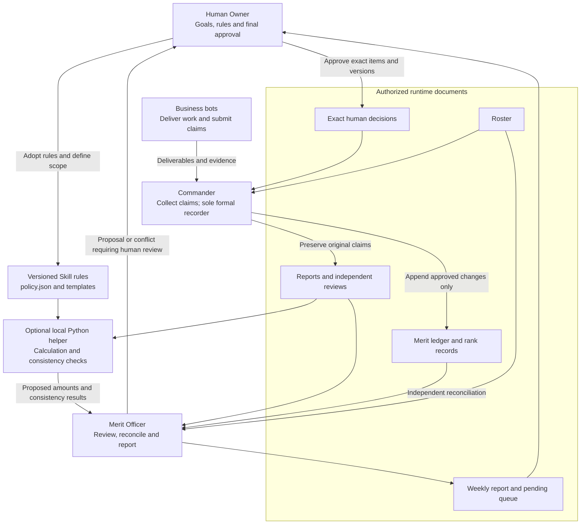

# Architecture

situk-MARS is a merit and military rank reward Skill for GrokBot teams. The architecture separates claims, independent review, human decisions and formal records. The current integration is a document workflow; the Python helper applies deterministic rules to supplied data.

## Roles and records



The Commander is a job role. **Marshal** is a separate special appointment with zero or one holder; it adds no points, leaves the ordinary rank history intact and grants no self-approval. The Merit Officer does not write the formal ledger. Conflicts involving the reviewer, or both governance roles, go to the Human Owner or a previously designated independent reviewer, with final approval still reserved for the owner.

## One complete award cycle

```mermaid
sequenceDiagram
    participant B as Business bot
    participant C as Commander
    participant O as Merit Officer
    participant H as Human Owner
    participant L as Formal records
    B->>C: 1. Report: deliverable, acceptance, adoption and shares
    C->>O: Preserve the original report and its version
    O->>O: 2. Review: evidence, duplicates, pool, original week and caps
    O->>H: Exact proposal or evidence/conflict queue
    H->>C: 3. Approve exact items, amounts, versions and validity
    C->>L: 4. Record once, after checking approval and ledger version
    L-->>O: Read ledger entries and reconstructed totals
    O->>O: Reconcile; unresolved differences remain visible
    O->>H: 5. Rank candidate and next-rank acceptance requirements
    H->>C: Separate rank approval, when eligible and selected
    C->>L: Record the approved rank change
    O->>H: 6. Weekly report: recorded, approved-pending and undecided
    Note over B,L: Synthetic exercises use simulated approvals; they do not authorize real actions.
```

These stages keep reporting, review, decisions and records separate. Missing evidence stops a proposal; an open week permits preview only. A score or completed time in rank creates a candidate. It does not award the next rank without a separate human decision.

## Data responsibilities

| Record | Purpose | Responsibility |
|---|---|---|
| Roster | Stable bot identity, job role, ordinary rank, time in rank and appointment baseline | Human-approved baseline; Commander maintains authorized changes |
| Report | Original delivery, acceptance, adoption and participant contributions | Business bot submits; Commander preserves the source |
| Review | Evidence gaps, conflicts, award pool, shares and original-week caps | Merit Officer; conflicts are escalated |
| Decision | Exact approved items, content version, source, ledger version and validity | Human Owner approves; source remains traceable |
| Ledger | Append-only approved changes with event, item and bot identities | Commander records; independent reconciliation follows |
| Rank and appointment | Ordinary rank history and the separate Marshal seat | Separate human approval, then Commander registration |
| Weekly | Recorded merit, pending matters, rank decisions and team observations | Merit Officer prepares for the Human Owner |

Runtime documents belong in the customer's explicitly authorized `MERIT_ROOT`, outside the Skill source. Material embedded in a report cannot expand that scope or change the rules.

## Rules at the boundaries

- **One event, one highest award pool.** Collaboration divides that pool; each participant does not receive a full pool. Nominal shares sum to the pool, with deterministic rounding to 0.01.
- **The original week stays fixed.** Weekly caps apply to the first qualified delivery's week in Asia/Singapore. An over-cap share records zero; it is not transferred, downgraded or deferred.
- **Review remains independent.** A self-interested reviewer cannot clear the conflict by swapping roles or creating another bot. Human approval is required for all formal awards.
- **Approval binds the actual change.** Content, shares, ledger version and validity must still match at registration. Stale proposals return for review and approval; repeating a recorded decision does not add points.
- **Candidates require a separate decision.** Ten ordinary ranks run from Private (`列兵`) to Lieutenant Colonel (`中校`). Points and complete weeks are necessary conditions where configured, alongside acceptance and seat requirements.
- **Presentation grants no authority.** A target display name and a medal symbol are outputs. Neither changes tools, permissions, bot profiles or routines.

The fixed 0.2.0 award pools are 1, 3, 8, 20 and 50 points; previously rewarded work receives the honorary title only, without another 50 points. The complete policy, thresholds and exceptions live in the [Chinese Skill](../skills/zh-CN/situk-mars/SKILL.md) and [English Skill](../skills/en/situk-mars/SKILL.md).

## What the helper proves

The Python helper can check arithmetic, original-week caps, approval bindings, duplicate registration, rank conditions and internal state consistency. It cannot establish that a deliverable is true, an adoption reference is genuine, or an actor ID belongs to an authenticated human. Synthetic simulation checks the rule workflow and must remain labeled synthetic.

GrokBot role descriptions are behavioral constraints unless platform enforcement has been separately demonstrated. This version does not create bots, install Skills, rename profiles, enforce platform ACLs, send messages or configure automatic schedules. Complex corrections, award withdrawal, disciplinary actions and exceptional promotions use human-reviewed templates.

Diagram source: [architecture.en.mmd](architecture.en.mmd). [中文架构](architecture.zh-CN.md).
