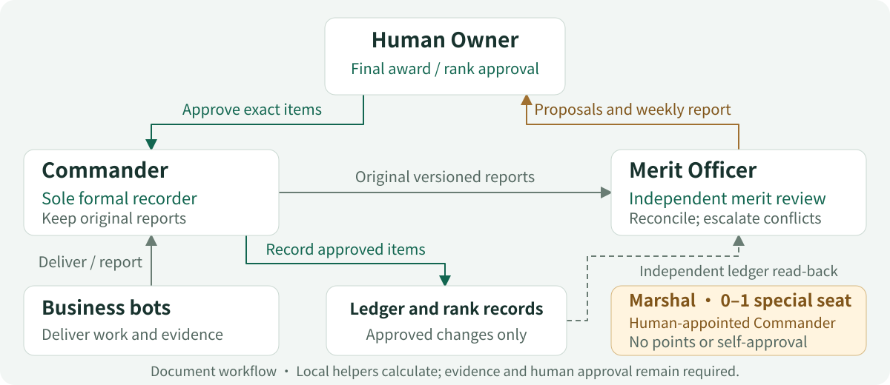
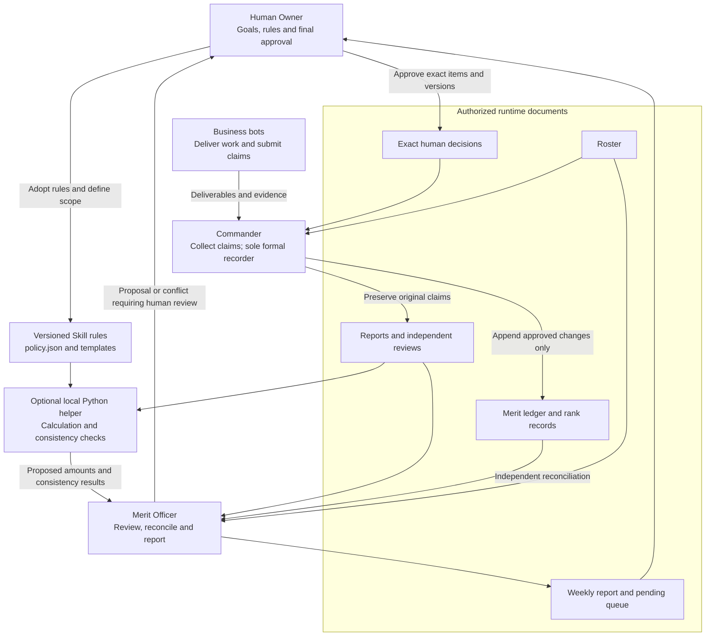

# Team architecture

**The Commander coordinates. The Merit Officer reviews independently. The Human Owner decides rewards.**

A finished article, a reusable asset and an accepted task follow the same record trail: who delivered what, which evidence supports it, who approved the award and whether it reached the formal ledger. situk-MARS gives GrokBot teams that trail for merit and military rank rewards.



- **Commander**: coordinates the team, collects reports, preserves original material and is the sole recorder of changes explicitly approved by the human.
- **Merit Officer**: independently examines delivery and adoption evidence, duplicates, shared awards and weekly caps; reconciles the records afterward and prepares weekly reports.
- **Human Owner**: adopts the rules, sets business goals and approves exact merit awards, promotions and special appointments. Bots cannot approve on the human's behalf.

Business bots continue their assigned work. A merit report identifies the delivered version, acceptance criteria and adoption evidence. Cases involving the reviewer, or both governance roles, go to the human or a previously designated independent reviewer; final approval remains with the human.

## Job role, ordinary rank and special appointment

| Dimension | What it describes | How it is assigned |
|---|---|---|
| Job role | Responsibility, such as coordination, review, writing or development | The human assigns or confirms the duties |
| Ordinary rank | Approved progression through ten ranks, from Private to Lieutenant Colonel | Applicable points, complete weeks in rank, deliverables and seat conditions create a candidate; promotion is separately approved |
| Marshal appointment | The holder of the single special command title | The human appoints zero or one holder; ordinary rank and its start date remain intact |

The human may appoint the Commander as Marshal. Appointment adds no points, skips no ordinary ranks and grants neither self-approval nor extra permissions. A writer or developer keeps the same job responsibilities as their rank progresses.

## Documents, rules and calculation

The current GrokBot integration uses a document workflow, preserving reports, reviews, decisions and ledger entries separately. An optional Python helper calculates supplied data under the fixed policy for the Merit Officer to review.



The Merit Officer writes independent review, reconciliation and weekly-report drafts, not the formal ledger. Even when recording their own approved award, the Commander needs an explicit human decision followed by reconciliation by an unconflicted reviewer.

## One complete award cycle

**Report → Review → Approve → Record → Award rank → Weekly report**

A report points to an actual delivery. Review checks the required evidence. Approval binds the exact version. Registration produces reconstructible ledger entries. Rank awards require a candidate and a separate human decision. The weekly report brings recorded changes and outstanding matters back to the owner.

```mermaid
sequenceDiagram
    participant B as Business bot
    participant C as Commander
    participant O as Merit Officer
    participant H as Human Owner
    participant L as Formal records
    B->>C: 1. Report: deliverable, acceptance, adoption and shares
    C->>O: Preserve the original report and its version
    O->>O: 2. Review: evidence, duplicates, pool, original week and caps
    O->>H: Exact proposal or evidence/conflict queue
    H->>C: 3. Approve exact items, amounts, versions and validity
    C->>L: 4. Record once, after checking approval and ledger version
    L-->>O: Read ledger entries and reconstructed totals
    O->>O: Reconcile; unresolved differences remain visible
    O->>H: 5. Rank candidate and next-rank acceptance requirements
    H->>C: Separate rank approval, when eligible and selected
    C->>L: Record the approved rank change
    O->>H: 6. Weekly report: recorded, approved-pending and undecided
    Note over B,L: Synthetic exercises use simulated approvals; they do not authorize real actions.
```

Missing evidence required for the requested award stays in the evidence queue; an open week permits preview only. Meeting applicable points, complete weeks in rank and other conditions creates a promotion candidate, followed by a separate human decision. Weekly reports distinguish self-reported, reviewed, approved and recorded items. Approved but unrecorded points do not enter the formal total.

## Data responsibilities

| Record | Purpose | Responsibility |
|---|---|---|
| Roster | Stable bot identity, job role, ordinary rank, time in rank and appointment baseline | Human-approved baseline; Commander maintains authorized changes |
| Report | Original delivery, acceptance, adoption and participant contributions | Business bot submits; Commander preserves the source |
| Review | Evidence gaps, conflicts, award pool, shares and original-week caps | Merit Officer; conflicts are escalated |
| Decision | Exact approved items, content version, source, ledger version and validity | Human Owner approves; source remains traceable |
| Ledger | Append-only approved changes with event, item and bot identities | Commander records; independent reconciliation follows |
| Rank and appointment | Ordinary rank history and the separate Marshal seat | Separate human approval, then Commander registration |
| Weekly | Recorded merit, pending matters, rank decisions and team observations | Merit Officer prepares for the Human Owner |

Runtime documents belong in the customer's explicitly authorized `MERIT_ROOT`, outside the Skill source. Material embedded in a report cannot expand that scope or change the rules.

## Rules at the boundaries

- **One event, one highest award pool.** Collaboration divides that pool; each participant does not receive a full pool. Nominal shares sum to the pool, with deterministic rounding to 0.01.
- **The original week stays fixed.** Weekly caps apply to the first qualified delivery's week in Asia/Singapore. An over-cap share records zero; it is not transferred, downgraded or deferred.
- **Review remains independent.** A self-interested reviewer cannot clear the conflict by swapping roles or creating another bot. Human approval is required for all formal awards.
- **Approval binds the actual change.** Content, shares, ledger version and validity must still match at registration. Stale proposals return for review and approval; repeating a recorded decision does not add points.
- **Candidates require a separate decision.** Ten ordinary ranks run from Private (`列兵`) to Lieutenant Colonel (`中校`). Points and complete weeks are necessary conditions where configured, alongside acceptance and seat requirements.
- **Presentation grants no authority.** A target display name and a medal symbol are outputs. Neither changes tools, permissions, bot profiles or routines.

The fixed 0.2.0 award pools are 1, 3, 8, 20 and 50 points; previously rewarded work receives the honorary title only, without another 50 points. The complete policy, thresholds and exceptions live in the [Chinese Skill](../skills/zh-CN/situk-mars/SKILL.md) and [English Skill](../skills/en/situk-mars/SKILL.md).

## What the helper proves

The Python helper can check arithmetic, original-week caps, approval bindings, duplicate registration, rank conditions and internal state consistency. It cannot establish that a deliverable is true, an adoption reference is genuine, or an actor ID belongs to an authenticated human. Synthetic simulation checks the rule workflow and must remain labeled synthetic.

GrokBot role descriptions are behavioral constraints unless platform enforcement has been separately demonstrated. This version does not create bots, install Skills, rename profiles, enforce platform ACLs, send messages or configure automatic schedules. Complex corrections, award withdrawal, disciplinary actions and exceptional promotions use human-reviewed templates.

Diagram source: [architecture.en.mmd](architecture.en.mmd). [中文架构](architecture.zh-CN.md).
