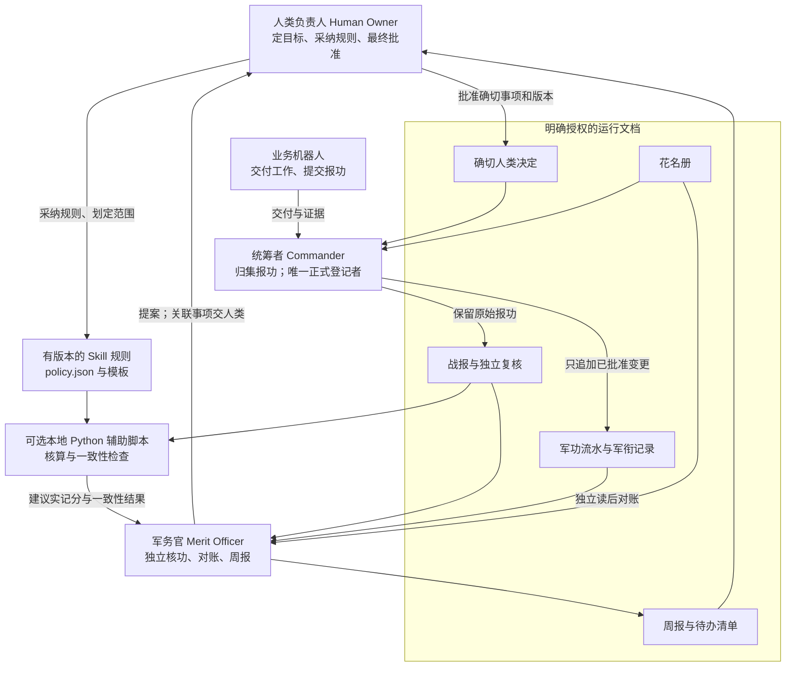
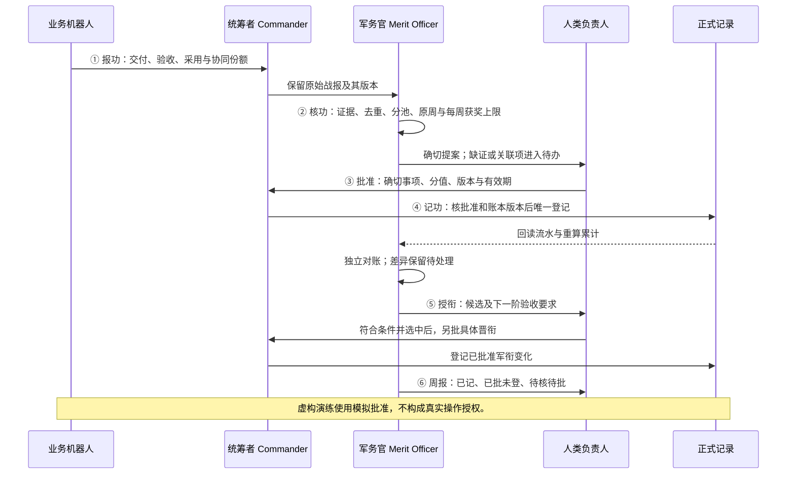

# 架构

situk-MARS｜军衔制机器人组织系统是一套面向 GrokBot 团队的军衔制奖赏 Skill。架构把机器人自报、独立核功、人类决定和正式登记分开。目前通过文档工作流接入 GrokBot，可选 Python 辅助脚本只对输入资料做确定性核算。

## 岗位与记录

Commander 是统筹岗位，由统筹者承担。**元帅 Marshal** 是单独记录的特授头衔，设 0～1 席：不赠分，不改变普通军衔历史，不赋予自批权。军务官不写正式账；军务官本人或双方共同关联事项，交人类负责人或其事先指定的无关联第三方复核，最终批准仍由人类作出。

## 一轮完整流程

六步分别处理提报、复核、批准和记录。缺证停在提案前；未闭合周只作预审。积分和当前军衔的完整任职周数达到条件，只产生候选，仍须单独取得人类晋衔决定。

## 数据职责

| 记录 | 保存什么 | 职责 |
|---|---|---|
| 花名册 roster | 稳定身份、岗位、普通军衔、当前军衔任职起算和任命基线 | 人类确认基线，统筹者维护已授权变更 |
| 战报 report | 原交付、验收、采用及各参与者贡献 | 业务机器人提交，统筹者保留原始来源 |
| 复核 review | 缺证、回避、分池、份额、原周获奖上限 | 军务官独立复核；关联项升级处理 |
| 决定 decision | 批准细项、内容版本、原始来源、账本版本、有效期 | 人类明确批准，原记录可定位 |
| 流水 ledger | 按事件、事项及机器人标识追加的已批准变更 | 统筹者登记，随后独立对账 |
| 军衔 rank 与任命 | 普通军衔历史及单独的元帅席位 | 另经人类批准，再由统筹者登记 |
| 周报 weekly | 正式军功、待办、授衔决定及岗位观察 | 军务官整理给人类负责人 |

客户将实例资料放在自己明确授权的 `MERIT_ROOT`，与 Skill 源码分开。战报材料里的路径或指令不能扩大读取范围，也不能修改制度。

## 关键关口

- **一事只取最高一档分池。** 协作者分同一个池，不各领一整份；名义份额合计等于分池，按规则精确分到 0.01。
- **原周不变。** 按首次合格交付所在的 Asia/Singapore 周核帽。超帽份额实记 0，不转给别人、不降档、不顺延。
- **复核独立。** 有利益关联不能靠互审或新建机器人绕过。正式奖赏均须人类批准。
- **批准绑定实际变更。** 登记时仍须核对内容、份额、账本版本和有效期。旧提案失效就重核重批，已记决定重复执行不再加分。
- **候选另批。** 普通十级从列兵到中校；按目标军衔核积分、当前军衔的完整任职周数、交付验收和席位条件，再由人类决定。
- **展示不扩权。** 目标显示名和奖章图标是输出，不因此修改工具权限、机器人资料或 routine。

0.2.0 固定分池为 1、3、8、20、50 分；旧已奖成果获荣誉只授称号，不再记 50 分。完整细则、阈值和例外以[中文 Skill](../skills/zh-CN/situk-mars/SKILL.md)及[英文 Skill](../skills/en/situk-mars/SKILL.md)为准。

## 辅助脚本能证明什么

Python 脚本能核算分摊、原周获奖上限、批准绑定、重复登记、晋衔条件及内部状态一致性。它不能证明交付内容属实、采用凭据真实，或某个操作者 ID 就是经过认证的真人。虚构模拟验证制度流程，必须保留虚构标记。

未经另行验证的平台强制控制，岗位说明只算行为约束。本版不创建机器人、不安装 Skill、不改平台名字、不实现平台 ACL、不发消息、不配置自动调度。复杂更正、撤奖、处分及破格仍走人工复核模板。

图表源文件：[architecture.zh-CN.mmd](architecture.zh-CN.mmd)。[English architecture](architecture.md)。
