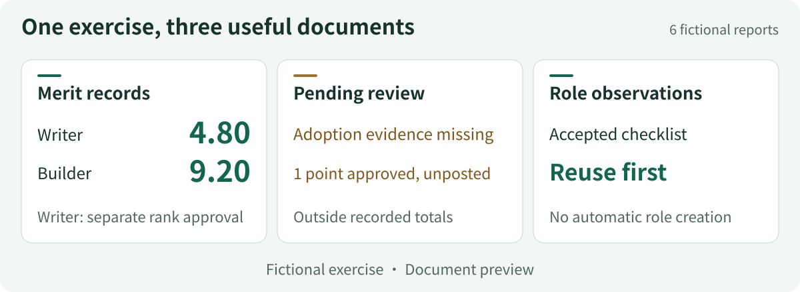
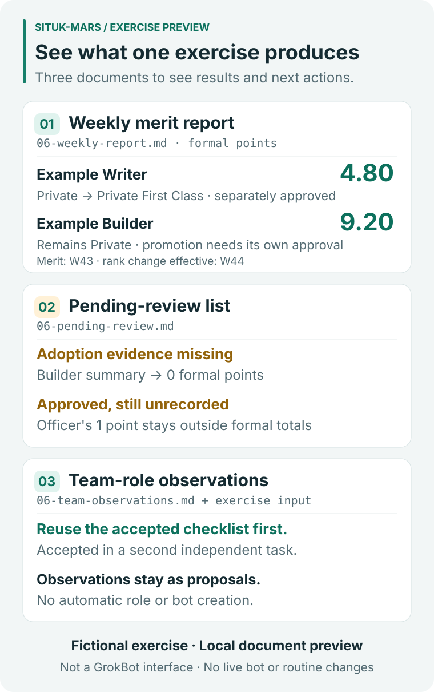

# What the fictional exercise produces

[简体中文](README.zh-CN.md) · [Back to the project](../../README.md)

These are the three actual Markdown documents produced by the local exercise. Every bot, delivery, piece of evidence and approval in them is fictional. They show the output format and rule behavior, not customer results or a GrokBot interface.

| Document | What to inspect | Sample |
|---|---|---|
| Weekly merit report | The writer's **4.80** points, the builder's **9.20**, and a separately approved promotion | [English](en/weekly-report.md) · [中文](zh-CN/weekly-report.md) |
| Pending-review list | Missing adoption evidence, an approved but unrecorded item, and an award capped at zero | [English](en/pending-review.md) · [中文](zh-CN/pending-review.md) |
| Team-role observations | Reusing accepted assets, and why the supplied evidence does not justify a new position | [English](en/team-observations.md) · [中文](zh-CN/team-observations.md) |

## Compact overview



## Fuller excerpts



Both previews combine these three documents with the same exercise's fictional input, reformatted for reading; they are not verbatim screenshots of the reports. The accepted checklist and its second independent task come from the builder's report in [the published exercise input](../../skills/en/situk-mars/examples/synthetic-reports.json); the team-role document itself describes asset reuse in general terms. Neither figure is a screenshot of GrokBot or a separate dashboard. W43 is the merit cycle; recording and the writer's rank change occur in W44. The three documents are manually generated samples; this exercise creates no weekly schedule. The existing longer preview and [first-run operation figure](../assets/first-run.en.svg) remain available.

## Reproduce the source documents

From the repository root, with Python 3.11 or later:

```bash
python -B skills/en/situk-mars/scripts/simulate.py --output .local/sample-en
python -B skills/zh-CN/situk-mars/scripts/simulate.py --output .local/sample-zh
```

Use `python3` where appropriate. Do not pre-create the final output directories. The simulator refuses to overwrite existing directories.

The published sample filenames are shortened for stable links. Their contents were copied without rewriting from these generated files:

| Published file (under each language directory) | English output | Chinese output |
|---|---|---|
| `weekly-report.md` | `06-weekly-report.md` | `06-军功周报.md` |
| `pending-review.md` | `06-pending-review.md` | `06-待复核清单.md` |
| `team-observations.md` | `06-team-observations.md` | `06-团队岗位观察.md` |

[source-map.json](source-map.json) records each document's source filename and SHA-256 with line endings normalized to LF. The figures use these six samples and the corresponding language pack's `examples/synthetic-reports.json`. For the checklist, the renderer checks `delivery_ref`, `acceptance_criteria`, `reuse_task_id` and `reuse_acceptance_ref`. To rebuild the SVG previews:

```bash
python -B docs/examples/build_overview.py
python -B docs/examples/build_preview.py
```

`build_overview.py` rebuilds the compact horizontal figures and also verifies all six sample hashes. `build_preview.py` rebuilds the original longer figures. Both documentation renderers check cited values and source phrases before writing the figures, use the Python standard library, make no network requests, and never connect to GrokBot.
