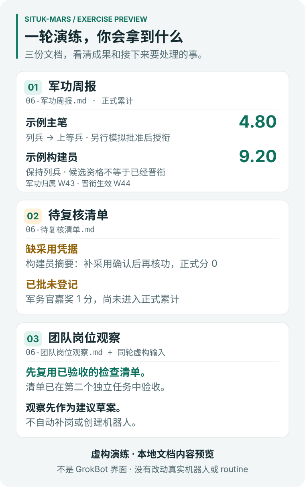

# 一轮虚构演练，会拿到什么

[English](README.md) · [返回项目首页](../../README.zh-CN.md)

这里是本地演练实际生成的三份 Markdown 文档。文中的机器人、交付、证据和批准全部是虚构的，只展示文档样式和规则行为，不代表客户成果，也不是 GrokBot 界面。

| 文档 | 重点看什么 | 完整样张 |
|---|---|---|
| 军功周报 | 主笔 **4.80** 分、构建员 **9.20** 分，以及另行批准的晋衔 | [中文](zh-CN/weekly-report.md) · [English](en/weekly-report.md) |
| 待复核清单 | 缺采用凭据、已批未登记，以及达到周上限后实记零分的事项 | [中文](zh-CN/pending-review.md) · [English](en/pending-review.md) |
| 团队岗位观察 | 先复用已验收资产，现有材料为何不足以支持新增岗位 | [中文](zh-CN/team-observations.md) · [English](en/team-observations.md) |



图里是三份样张及同轮虚构输入的整理预览。已验收的检查清单及其第二个独立任务，来自[公开演练输入](../../skills/zh-CN/situk-mars/examples/synthetic-reports.json)中的构建员战报；团队岗位观察原文只作了概括的资产复用说明。它不是 GrokBot 截图，也不是另一个看板产品。军功归属 W43，登记和主笔的晋衔发生在 W44。三份文档是手动生成的样例，演练没有建立每周调度。

## 复现原始文档

在仓库根目录，用 Python 3.11 或更新版本运行：

```bash
python -B skills/zh-CN/situk-mars/scripts/simulate.py --output .local/sample-zh
python -B skills/en/situk-mars/scripts/simulate.py --output .local/sample-en
```

部分系统需把 `python` 改成 `python3`。最后一级输出目录不要提前创建，模拟脚本会拒绝覆盖已有目录。

公开样张只把文件名缩短以便稳定链接，内容直接复制，没有重写。对应的实际输出文件名如下：

| 样张文件（位于各语言目录下） | 中文输出文件 | 英文输出文件 |
|---|---|---|
| `weekly-report.md` | `06-军功周报.md` | `06-weekly-report.md` |
| `pending-review.md` | `06-待复核清单.md` | `06-pending-review.md` |
| `team-observations.md` | `06-团队岗位观察.md` | `06-team-observations.md` |

[source-map.json](source-map.json) 记录每份样张的原始文件名和 SHA-256，计算时统一换行符为 LF。图中材料来自这六份样张及对应语言包的 `examples/synthetic-reports.json`。关于检查清单，制图脚本会核对交付路径 `delivery_ref`、验收条件 `acceptance_criteria`、独立复用任务 `reuse_task_id` 和复用验收依据 `reuse_acceptance_ref`。重建两种语言的 SVG：

```bash
python -B docs/examples/build_preview.py
```

制图脚本会先核对引用的分数和原文要点，再写入图形。它只用 Python 标准库，不联网，不连接 GrokBot。
