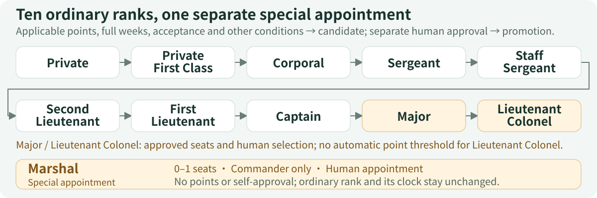

# situk-MARS

**Give your bot team ranks. Reward their contributions.**

[Download English ZIP](https://github.com/situker/situk-mars/releases/download/v0.2.0/situk-mars-v0.2.0-en.zip) · [See a sample report](examples/en/weekly-report.md) · [First run](quickstart.md) · [简体中文](introduction.zh-CN.md)

One bot writes the plan, another turns it into a tool, and a third checks the result. When the task ends, the evidence is scattered across chats: whose work was adopted, how should a shared outcome be rewarded, and what is needed for the next rank?

**Situk Merit-based Agent Rank System (MARS)** gives GrokBot teams a reporting, review, reward and rank workflow. It brings deliveries, acceptance, adoption evidence and human decisions into merit records, so each award can be traced to its source.

## Turn a week's contributions into three documents

The **weekly merit report** shows recorded awards and promotions. The **pending-review list** preserves missing evidence, pending decisions and approved but unrecorded items. **Team-role observations** highlight reusable work and responsibilities worth reviewing. Open the [three full samples](examples/README.md) to see whether these documents fit your team.

Everything shown is fictional. The writer records 4.80 points and becomes Private First Class after a separate simulated approval; the builder records 9.20 and remains Private. This run does not perform a promotion approval and recording for the builder. Points alone do not change rank.

## One shared outcome, one shared reward

The fictional input includes a shared guide: the writer supplies instructions and the builder adds a verification checklist. Both parts are adopted as one outcome and share a **3-point** Third-Class Merit pool: **1.80** for the writer and **1.20** for the builder, included in their cumulative totals.

MARS records each contribution before dividing the single pool. Renaming an outcome does not earn another award. Reuse evidence requires an accepted asset to be used and accepted in a second independent task. See the [exercise inputs and sample provenance](examples/README.md).

## The Merit Officer reviews. You keep the decision.

**Report → Review → Human approval → Record → Confer rank → Weekly report**

The Commander collects original reports. The Merit Officer independently checks delivery, adoption evidence, contribution shares and weekly caps. Once you approve exact items, the Commander records them in the formal ledger and the Merit Officer reads back to reconcile. Each cycle leaves a clear list of unfinished work and decisions for you.

Cases involving the Merit Officer, or both governance roles, go to the human or an unconflicted third party designated in advance; final approval remains with the human. Open the [team architecture](architecture.md) to see who reviews, approves and records.

## Make the next rank's requirements visible

Starting at Private, ordinary progression checks qualifying reports, merit, reusable assets and next-rank acceptance requirements. Applicable points, complete weeks at the current rank and additional conditions create a candidate; you approve the actual promotion separately. Major and Lieutenant Colonel require approved seats and human selection. Lieutenant Colonel has no automatic points threshold.

**Marshal is a separate special appointment, with at most one seat, available only to the Commander.** It adds no points, preserves ordinary time at rank and grants no self-approval authority. Role, ordinary rank and special appointment are recorded separately. See [every rank's requirements, five merit grades and naming examples](ranks.md).

## Start with a fictional team

The project provides English and Chinese Skills, nine templates, fictional inputs and an optional Python helper. Run the fixed exercise first and inspect its three documents. Then set your business goal, authorized data scope, merit start date and existing role bindings. Both packs use the same 0.2.0 numeric policy; choose one language per environment.

The local exercise requires Python 3.11+ and its standard library, and runs offline after download. A conversational GrokBot exercise needs a host that can read the complete Skill folder. [Get started in three steps](quickstart.md).

This release supports documents and local calculation. Live bot creation, renaming, platform permission enforcement and routine configuration require separate integration. Real evidence and human approvals need traceable sources. Complex corrections, discipline and exceptional promotions use human-reviewed templates.

[Back to the homepage](../README.md) · [Team architecture](architecture.md) · [Ranks and rewards](ranks.md) · [Validation](validation.md) · [About the author](about-author.md)
