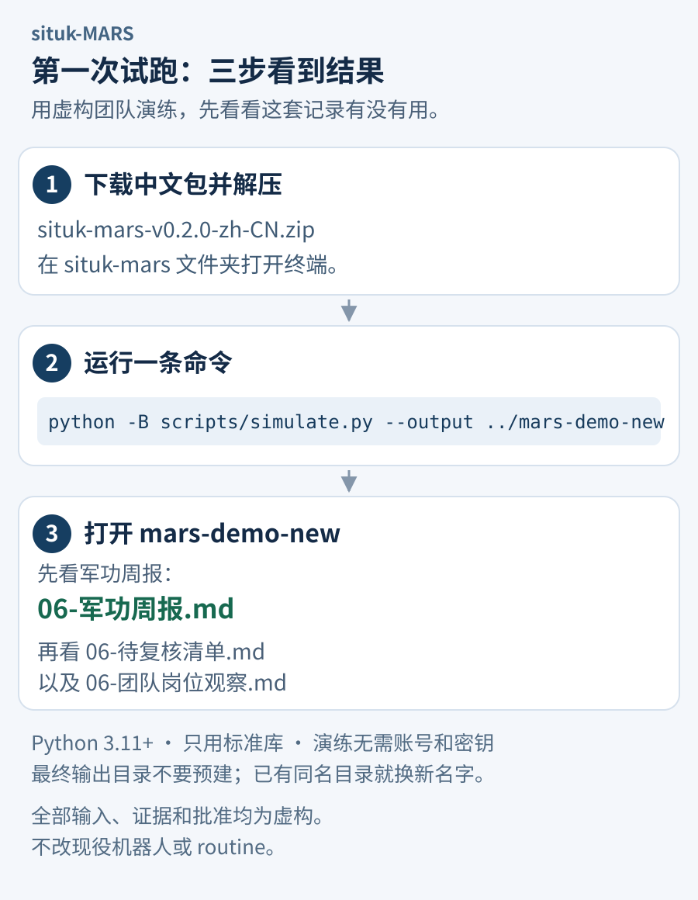

# 第一次试跑：先看看周报会长什么样

先用虚构团队跑一轮，不用先整理真实机器人名单。你会拿到军功周报、待复核清单和团队岗位观察，看看这些材料是否能帮你管理团队。

[下载中文包](https://github.com/situker/situk-mars/releases/download/v0.2.0/situk-mars-v0.2.0-zh-CN.zip) · [先看周报样张](examples/zh-CN/weekly-report.md) · [English](quickstart.md)

两条路线任选其一。**本地 Python 路线可直接复现；GrokBot 路线取决于当前宿主能否读取完整文件夹。**



## 路线 A：在本地生成三份结果

需要 **Python 3.11 或更新版本**，只用标准库。演练无需账号、密钥、网络或安装第三方依赖；下载文件时需要联网。

1. [下载中文 ZIP](https://github.com/situker/situk-mars/releases/download/v0.2.0/situk-mars-v0.2.0-zh-CN.zip)，解压，打开里面的 **`situk-mars` 文件夹**。在该文件夹打开终端。
2. 运行这一条命令：

   ```bash
   python -B scripts/simulate.py --output ../mars-demo-new
   ```

3. 打开与 `situk-mars` 并列的新文件夹 **`mars-demo-new`**，先看 **`06-军功周报.md`**，再看 **`06-待复核清单.md`** 和 **`06-团队岗位观察.md`**。可用支持 Markdown 的编辑器预览，也可直接按文本打开。

如果你的 Python 3 命令是 `python3`，把命令开头的 `python` 换成 `python3`。**不要提前创建 `mars-demo-new`，空目录也不行。** 脚本会新建输出目录；如果同名目录已经存在，把命令末尾改成 `../mars-demo-2` 等新名字，保留已有资料。

### 先看这三处

| 打开的文档 | 重点看什么 | 演练中可以核对的结果 |
|---|---|---|
| `06-军功周报.md` | 已记军功、普通军衔和特授 | 示例主笔 **4.80 分**，经单独模拟批准升上等兵；示例构建员 **9.20 分**，仍为列兵 |
| `06-待复核清单.md` | 缺证、待核、已批未登记 | 军务官已获模拟批准但未登记的 **1 分**，不计入正式累计 |
| `06-团队岗位观察.md` | 可复用成果与资料覆盖范围 | 只有有限的虚构材料，不据此认定真实缺岗或新增机器人 |

这些结果都来自随包虚构输入，证据和人类批准同样是模拟的。你可以对照[周报](examples/zh-CN/weekly-report.md)、[待复核清单](examples/zh-CN/pending-review.md)和[岗位观察](examples/zh-CN/team-observations.md)的公开样张。

## 路线 B：让 GrokBot 在对话中演练

把**完整解压文件夹**放在当前 GrokBot 宿主可读取、且你授权的位置，提供其中 `SKILL.md` 的实际路径。仅发 GitHub 页面链接、复制一段 Skill 正文，不能保证它读到规则、模板和示例。

平台的文件读取、导入和工具操作方式尚未在本项目中统一验证。若当前宿主不能读取完整文件夹，使用路线 A；不要把下面的提示词当作一键安装命令。

将实际路径与这段提示词一起发给 GrokBot：

```text
读取我提供的完整 situk-MARS 中文 Skill 文件夹，从 SKILL.md 开始，再按其中引用读取规则、模板和示例。

先在当前对话中，用虚构机器人完整演练报功、核功、人类批准、记功、授衔和周报。所有机器人、证据和批准都明确标为模拟；模拟批准只对本轮虚构事项有效，不能用于真实奖赏。

最后给我军功周报、待复核清单和团队岗位观察，说明已记成果、待补证和待决定事项。没有依据就写待核，不编造真实业务成效。

不要读取真实花名册，不安装 Skill，不创建、修改或改名机器人，不读取、修改、触发或新建 routine。若不能读取完整文件夹或不能执行某一步，说明缺口，不声称已经完成。
```

## 看完一轮，再决定怎样接入

演练不需要先配置真实人类负责人或岗位。决定试用真实业务时，再确定负责人、业务目标、授权资料目录、新功起算时间和现有角色绑定，先手动跑通一轮。接入细节见[在 GrokBot 中使用](../skills/zh-CN/situk-mars/references/grokbot-usage.md)。

两种语言包共用 Skill ID `situk-mars`，同一环境选择一种。军衔、奖章和目标显示名是制度记录；真实平台改名、建岗和调度需要各自接入与授权。

[返回中文首页](../README.zh-CN.md) · [查看架构](architecture.zh-CN.md) · [下载现有 v0.2.0](https://github.com/situker/situk-mars/releases/tag/v0.2.0)
