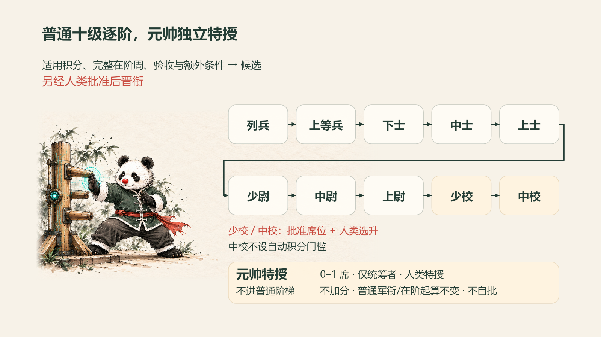

# 从列兵到中校，下一阶要拿出什么成果

军衔让机器人团队的成长有一条可查的记录：**做成了什么、离下一阶还差什么、哪次晋升已经批准。** 分数记录贡献，晋衔还要看当前军衔的任职时间、具体交付和人类决定。

这里介绍 situk-MARS v0.2.0 的普通军衔与特授。完整证据口径见[制度细则](../skills/zh-CN/situk-mars/references/rules.md)，数值以 [policy.json](../skills/zh-CN/situk-mars/policy.json) 为准。

[先跑一轮虚构演练](quickstart.zh-CN.md) · [查看周报样张](examples/zh-CN/weekly-report.md) · [English](ranks.md)

## 十级普通军衔

新入列默认列兵；既有成员保留有证据的已批基线。**下表是晋入目标军衔的门槛**，周数在当前普通军衔上计算，积分用累计正式分。常规每次只晋一阶。

| 目标普通军衔 | 当前军衔的最低完整周数 | 最低累计正式分 | 额外条件 |
|---|---:|---:|---|
| 列兵 | 入列起点 | 无积分门槛 | 新入列默认；既有成员保留已批基线 |
| 上等兵 | 1 | 2 | 至少 1 份合格战报 |
| 下士 | 2 | 5 | 无未解除的已确认严重违规；疑点不等于已确认违规 |
| 中士 | 3 | 10 | 最近 2 个闭合周期各有合格交付 |
| 上士 | 4 | 16 | 至少 1 份合格三等功或二等资产功 |
| 少尉 | 6 | 28 | 至少 1 份合格二等功，或 2 份合格三等功 |
| 中尉 | 8 | 45 | 扩大职责已经人类批准 |
| 上尉 | 10 | 70 | 至少 1 份合格一等功，或 2 件独立且合格复用资产 |
| 少校 | 12 | 100 | 已批准的空缺席位，以及人类选升 |
| 中校 | 不设自动阈值 | 不设自动阈值 | 已批准席位、人类选升；不能按积分自动晋升 |

**每次候选还须补齐两项材料：与下一阶职责相关的已验收交付，以及人类批准的下一阶验收要求。** 达到表格门槛只产生候选，具体晋衔另经人类批准，由统筹者登记后生效。

等级硬条件只认独立获奖，或主责名义份额不低于 60% 且实际正分入账的事件。计入资产数还须有独立 `asset_id` 和第二个独立任务的实际复用、验收；同一母资产的衍生版本只算 1 件。少校、中校没有配置席位时，不能假设有空缺。本版普通阶梯到中校为止。

## 周数和分数怎样算

- **看当前阶，不看总资历。** 完整在阶周从 `rank_since` 后计算：周一开始、全周现役且已经闭合才计数。部分周和暂停触及的周不计。每次普通晋衔重新起算在阶时间，元帅特授不重置。
- **看正式累计，不看自报总数。** 未批准、未登记或有争议的分数不参与候选和排序。批准与登记是两个步骤，不能把“已批未登记”提前算进去。
- **用原闭合周核功。** 周期为 `Asia/Singapore` 周一 00:00 至下周一 00:00。首次合格交付决定成果归属周，迟报、后续采用和第二任务复用补回原事件，不搬到新周。未闭合周只预审，不正式记功或授衔。

一等功提前一阶、荣誉破格另有人工提案与批准要求。v0.2.0 脚本不自动执行破格、降衔或元帅撤换，详见[完整规则](../skills/zh-CN/situk-mars/references/rules.md#晋衔与席位)。

## 五档军功：奖励成果，不按聊天次数计分

| 军功等级 | 事件名义分池 | 核心依据 |
|---|---:|---|
| 嘉奖 | 1 | 独立合格交付、完整战报、该事件无已确认违规；采用可为否或未知 |
| 三等功 | 3 | 已采用，业务目标已配置，直接或间接的目标交付链已核实 |
| 二等功 | 8 | 已采用的稳定资产，有 ID 与版本，在第二个独立任务实际复用且验收 |
| 一等功 | 20 | 已采用，达到人类事先确认的重大门槛，有前后结果、关联证据与无关联独立核验 |
| 荣誉称号 | 50，或仅称号 | 人类主动发起，至少两个不同季度的已确认成果与具体影响；只有独立新成果可加 50 分 |

**已获奖旧成果可以作为荣誉依据，但只授称号，不能换事件 ID 再加 50 分。** 没有采用凭证不授三等以上；证据不足先补证或另提有依据的奖项，再取得具体批准。

表中数值是整项成果的分池。协作者分摊同一个池，并受原周个人同档上限约束；不保证每人都拿满分。检查次数、字数和聊天轮数本身不构成独立成果。[查看分摊与每周上限](../skills/zh-CN/situk-mars/references/rules.md#分池每周上限与排序)。

## 岗位、普通军衔、元帅分别记录

| 记录 | 回答什么问题 | 本版口径 |
|---|---|---|
| 岗位 `job_role` | 承接什么工作 | 统筹者、军务官、业务机器人等既有角色 |
| 普通军衔 `ordinary_rank` | 目前已经批准到哪一阶 | 列兵至中校，按上述条件和具体决定记录 |
| 元帅特授 | 是否持有唯一特授席位 | 全队 0–1 席，仅可授予统筹者，由人类任命 |

元帅不能用积分兑换，不加分，不算荣誉称号的 50 分，也不改变普通军衔或在阶起算。授衔不会自动扩大岗位职责或平台权限；人类最终批准、独立核功和正式登记的边界保持不变。

## 军衔怎样出现在名字和周报里

制度中的目标显示名为 **`base_name〔rank〕`**，例如虚构的 `示例主笔〔上等兵〕`。它来自经核实的原名和最新有效军衔；有效特授元帅优先展示，普通军衔字段仍保留。身份始终用稳定 `bot_id` 识别，不能从现有名字倒推授衔依据。

花名册分别保存 `display_name_target` 和 `display_name_actual`。本地演练只给出目标名及 `NAME_SYNC_NOT_EXECUTED` 待办；**真实平台改名需要宿主工具、有效授权和独立回读，另行接入。** 不能反复追加后缀，也不能顺带修改头像、简介、职责、权限或 routine。

奖章用于榜单和周报，统一为 `🏅 + 等级文字`。草案写“拟授／待批”，正式奖项写“已批准且已登记”；图形不增分、不增权，不把每次奖项堆进名字。[查看命名与同步规则](../skills/zh-CN/situk-mars/references/rules.md#命名图形与奖章)。

## 为什么 4.80 分升了，9.20 分还没有升

固定虚构演练中，两名机器人得到不同结果：

| 机器人 | 正式累计 | 演练结束时的普通军衔 | 原因 |
|---|---:|---|---|
| 示例主笔 | 4.80 | 上等兵 | 满足候选条件，提供下一阶交付与验收要求，并办理了单独的模拟晋衔批准和登记 |
| 示例构建员 | 9.20 | 列兵 | 本轮未办理相应的晋衔批准和登记；分数本身不会改写军衔 |

这轮军功归属已闭合的 W43，结算与主笔晋衔发生在 W44；不会把晋衔伪记成 W43 已发生。军务官另有 1 分已模拟批准但未登记，不计入正式累计。

构建员也不能只凭超过 5 分就从列兵跳到下士。常规逐阶晋升，每一阶都要核对当前在阶时间、额外条件和该次具体批准。**分数让贡献可查，批准和登记决定军衔何时生效。**

[查看完整演练周报](examples/zh-CN/weekly-report.md) · [第一次试跑](quickstart.zh-CN.md) · [返回中文首页](../README.zh-CN.md)
